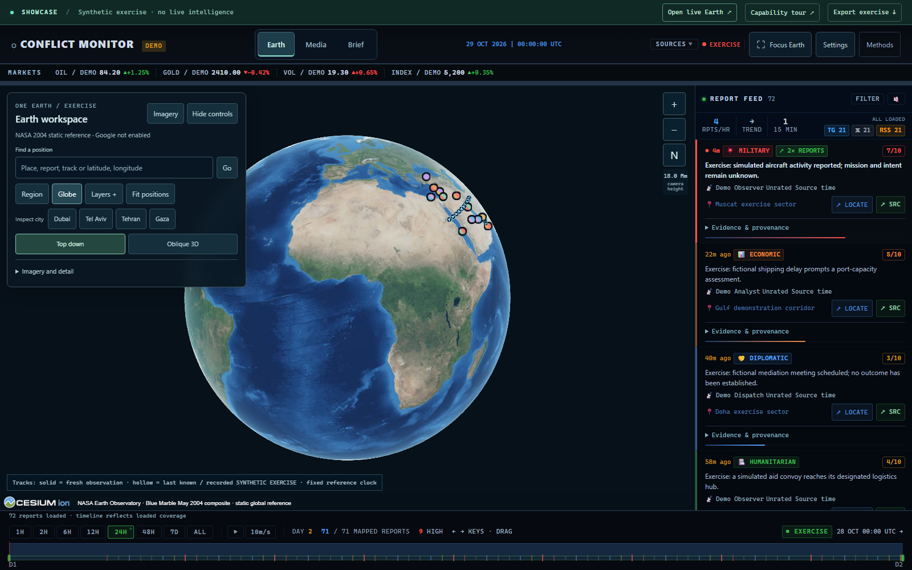

# Conflict Monitor

An OSINT workspace centered on one persistent Google Earth canvas, with source reports, regional ADS-B/AIS, thermal observations, replay, Media and Brief panels. It preserves original evidence and makes source age, unresolved locations and coverage limits visible. Optional local Qwen extraction and Piper/FFmpeg narrated source cards use no paid inference or speech API.

**0.2.0-rc.5 development candidate.** The current source adds report search and retained filters, an isolated public reader, immutable NASA thermal and adsb.lol aircraft datasets with exact downloads, and a resource-limited collector profile for a shared PC. Public datasets preserve their separate licenses and attribution; private reports, generated media and operator controls remain withheld. Thermal pixels and reported aircraft positions do not establish a confirmed conflict incident. The exact RC.5 security and long-session qualification is still in progress; prior RC.4 results do not qualify this build. See [current verification](docs/VERIFICATION.md), [public data](docs/PUBLIC_DATA.md), [public hosting](docs/PUBLIC_HOSTING.md) and the [website integration assessment](docs/WEBSITE_INTEGRATION.md).

Telegram collection defaults to disabled. An operator deployment can use a publisher-authorized Bot API connector without a personal account session. This candidate retains [committed report delivery](docs/EVENT_DELIVERY.md), durable recovery of future-dated RSS receipts and Media resource cleanup.

The local RC.4 frontend build `75a234f02100` passed 405 tests. Its exact live profile passed 12 Google Earth browser/viewport combinations and a separate iPhone 15 WebKit emulation recheck. An independent four-hour confirmation passed 3,840 REST requests, 48 SQL checks, 27 natural publication offsets and automatic Google session renewal. Earlier timeout and identity-observation findings remain in the [verification record](docs/VERIFICATION.md). Physical-device behavior remains unmeasured.

The [published RC.2 prerelease](https://github.com/DankWoodsmoke/conflict-monitor-public/releases/tag/v0.2.0-rc.2) retains its original verification evidence. The newer source is a CI review candidate. Independent source/binary review ties known High findings to implemented fixes or absent affected code; raw scanner matches and Python Low/BusyBox Medium residuals remain retained. The new four-hour soak, post-soak advisory refresh and public-hosting qualification remain pending. Public tag, release assets and merge/tag CI remain pending. See [security review](docs/OS_SECURITY_REVIEW.md).

[](https://github.com/DankWoodsmoke/conflict-monitor-public/actions/workflows/verify.yml)

## Explore without credentials

Use Node.js 22.12 or newer:

```sh
cd frontend
npm ci
npm run dev
```

Open **http://localhost:5173/?showcase=true**. The explicit exercise uses local cartography and synthetic reports, tracks, media panels, markets and analysis. No database or model service is required. The capability tour opens panels within Earth; export saves the exercise data and reference clock. Earlier `view=map` and `view=3d` links resolve to Earth.

The **Earth** view uses Cesium and Google Photorealistic 3D Tiles. Configure a browser-restricted Google Maps key in Settings to enable detailed photography. A self-hosted deployment can set `GOOGLE_EARTH_ENABLED=true` and `GOOGLE_MAPS_BROWSER_KEY` for automatic Earth configuration without rebuilding the frontend. That explicitly public browser key is delivered by `/config`; backend credentials remain server-only. Google requires its Map Tiles API, billing and visible attribution. Imagery dates and 3D coverage vary; it is not a live satellite feed and does not establish an event's date or location.

**To inspect real imagery**, leave the keyless exercise using **Open live Earth**, select a reference city such as Dubai or Tehran, then choose **Top down** or **Oblique 3D**. **Focus Earth** expands the desktop workspace; **Imagery and detail** exposes the provider, loading state and balanced/detail setting. Native-resolution rendering is bounded to 2× device pixel ratio and eight million pixels. Controls collapse on small screens, while Earth, Media and Brief share the same canvas. On imagery failure a named reference layer remains available with an explicit retry. The keyless exercise uses a static NASA May 2004 daytime globe for orientation; it cannot show city detail.

## Capabilities

| Workspace | Implemented capability | Verification boundary |
| --- | --- | --- |
| Earth | Persistent Cesium/Google imagery, close city views, native-resolution/detail controls, focus mode, report feed and filters, coordinate/place search, source selection, regional aircraft/vessels, thermal observations and replay | Unknown locations stay unplotted. Tracking is explicitly projected onto the surface; no altitude conversion or motion extrapolation is invented. Unknown headings use a neutral marker. |
| Media panel | External media activation and real locally narrated source-card MP4s, with segment-timed captions and an exact narration transcript, preserving the Earth camera | Video reads attributed reports; it contains no incident footage. Caption timing is per source card, not word aligned. External broadcasters retain their own availability and rights. |
| Brief panel | Source digest, report references and optional local topic/stance/mention extraction; inherited analysis remains labeled | Model labels and source mentions remain unreviewed. Literal spans and valid JSON do not establish factual truth or an incident location. |
| Evidence | Preserved original reports, content hashes, source-scoped identities, revisions, explicit extraction failures | Report/network counts never automatically become independent confirmation. |
| Tracking | Four bounded regional ADS-B circles, AIS, explicit fresh/last-known ages, recorded replay and optional navigation-quality candidates | Partial receiver coverage is explicit. Expired positions disappear. Navigation degradation alone does not establish jamming. Active orbital markers and cosmetic sensor-like shaders have been removed. |

The default free profile preserves publisher text with `UNSCORED` severity and unresolved locations unless a sensor supplies coordinates. It never sends those reports to a paid classifier. Optional model-assisted extraction/synthesis requires deliberate configuration and separate accuracy qualification.

## Demonstrate the workspace

1. Open live Earth and enable Google imagery through Settings or your deployment's restricted browser key. Choose a city view, inspect the imagery at street/building scale, then use Focus Earth or Top down/Oblique 3D. Check provider attribution and source health before describing anything as current. The keyless showcase labels its synthetic data and static reference globe explicitly.
2. Explore reports and source/time filters, open a cited source, then compare its publication clock with collection time. Unlocated reports stay in the feed. Tracking controls distinguish fresh, last-known and recorded positions; the four aircraft regions describe the actual coverage.
3. Open Media, then return to Earth to show that the camera and canvas persist. External broadcasts need deliberate activation; an embedded page is not proof of live playback. The narrated briefing contains editorial source cards, not incident footage.
4. Open Brief for the attributed source digest and, when configured, optional local analysis. Inspect original citations and unreviewed labels. Local generation requires the operator key and a deliberate action; opening a panel starts no inference or speech job.

The capability tour and export in the keyless showcase can demonstrate these controls without disclosing credentials or redistributing live publisher text. See [verification](docs/VERIFICATION.md) for measured browser, source and media behavior.

## Preview

These previews show the synthetic, keyless exercise with the **NASA Blue Marble May 2004 daytime reference** at globe scale. They do not depict the detailed Google imagery available in a configured deployment. Use **Open live Earth** and an inspection-city control to see that capability.



Also see [Media](docs/screenshots/may2004-showcase-media-desktop-20261030T001722Z.png), [Brief](docs/screenshots/may2004-showcase-brief-desktop-20261030T001722Z.png) and [390-pixel portrait](docs/screenshots/may2004-showcase-earth-portrait390-20261030T001722Z.png). The [preview receipt](docs/screenshots/may2004-showcase-20261030T001722Z-receipt.json) binds them to the earlier `03b08f` image, with no external imagery, live-data or generation requests. They are retained previews of that phase, not final RC.2 UI qualification or current imagery/source truth. Original RC.1 previews remain preserved. The live workspace uses the operator's configured Google imagery and offers close city inspection; these public screenshots deliberately use the distributable NASA reference.

The optional free tools are configured in [local AI/video](docs/LOCAL_AI_VIDEO.md). The application never pulls a model or voice automatically. Operator-triggered work is authenticated, bounded and published only after its respective validation gates. The measured model comparison includes rejected batches and remaining errors. The inherited paid standalone video script is retained as historical source; automatic paid generation remains disabled by default.

The optional GOOL operator CLI reviews a frozen packet privately through an explicitly selected model route. It requires an existing GOOL checkout and exact packet approval. See the [operator workflow and measured route](docs/GOOL_REVIEW.md).

Narrated briefings verify the manifest's exact narration hashes before enabling captions or the transcript. Production Firefox testing retained a paused-frame caption repaint failure: user-triggered playback restored the visible captions, while the transcript remained available. Chromium/WebKit passed strict paused restoration. The page explains the Firefox recovery without forcing playback or seeking; it is not counted as a third paused-repaint pass. No physical iPhone, screen reader or native mobile background/eviction behavior is certified.

## Self-host with an empty database

Copy `.env.example` to `.env`. Set different new `POSTGRES_PASSWORD` and `POSTGRES_APP_PASSWORD` values (32 random bytes, represented as 64 hexadecimal characters each), plus a new `ADMIN_API_KEY`, then:

```sh
docker compose up --build
```

Open **http://localhost:5173/**. Collection defaults to disabled. Configure your own providers before setting `LIVE_INGESTION_ENABLED=true`. Paid situation reports additionally require `ENABLE_SITREP_GENERATION=true` and a configured model key. Administrative writes require `X-Admin-Key`; a missing server key disables them.

Compose builds PostgreSQL 17.11 and PostGIS 3.6.4 on a pinned Alpine 3.24 base. The reduced profile retains core spatial, topology and Tiger support and excludes raster, address standardizer and SFCGAL. It uses the reviewed FlatGeobuf backport and Alpine's signed su-exec to drop to UID 70. A one-shot `migrate` service initializes Alembic and grants the separate `monitor` runtime role. HTTP workers receive no database administrator secret. **Existing data requires a rehearsed logical restore into a new volume**, with the old volume and rollback profile preserved. The default `pgdata17_36_alpine` is a fresh volume. The change from glibc to musl can change Unicode ordering even when locale names match. See [database upgrade and permissions](docs/DB_UPGRADE.md).

The shipped profile runs backend UID 10001 and frontend UID 101 with dropped capabilities and no new privileges. Frontend and database root filesystems are read-only. The database entrypoint uses a short initialization capability list and its observed PostgreSQL PID 1 runs as UID 70 with zero effective capabilities. Local ports bind to loopback. The database has no published port. See [verification](docs/VERIFICATION.md).

The original April production dump was recovered separately into a private, isolated archive: all 53,715 rows round-tripped exactly. It contains legacy schema, source-clock anomalies and 5,991 dummy event coordinates, so it was preserved without merging its claims or locations into live data. See [historical recovery](docs/HISTORICAL_RECOVERY.md). No publisher bodies or private database are part of this source release.

Development API: `cd backend && uvicorn app.main:app --host 127.0.0.1 --port 8000`. Vite proxies `/api`; the production frontend uses the same-origin nginx proxy. `/health` checks the database/schema, `/status` reports process state and provider-specific freshness. A running process does not establish fresh upstream observations.

## Verify

```sh
python -m venv .venv
# Windows: .venv/Scripts/python.exe; POSIX: .venv/bin/python
python -m pip install -r backend/requirements-dev.txt
cd backend
python -m pytest -q
cd ../frontend
npm ci
npm test
npm run build
npm audit
```

The fresh-PostGIS gate is `python tools/verify_postgis.py` with `DATABASE_URL` naming a separately initialized `conflict_monitor_test` database. Initialize it through `python -m app.bootstrap` as the administrator, then run the gate as the restricted runtime role. The separate actual HTTP/WebSocket gate can additionally exercise `python tools/verify_live_pipeline.py --public-feed`. Missing infrastructure returns an incomplete/failing exit code. The [final backend-image run](docs/qualification/2026-10-30-rc2-linux-backend-597.json) passed 597 tests plus 29 subtests with no application-source mount. The 45-minute shipped-Compose CI job built all three images and passed actual restricted-role/PostGIS/TCP, container-boundary and seven header/cache cases on [qualified source commit b15a60eb](docs/qualification/2026-10-30-rc2-hosted-qualified-source-ci.json). It used isolated synthetic fixtures; the initial failed network/test runs remain preserved. Final source/tag qualification remains separate from that source-commit pass.

The [earlier b6e6 production browser receipt](docs/qualification/2026-10-30-rc2-mobile-accessibility.json) records 102 axe states with no reported violations, 71 keyboard samples, 30 reflow states, 12 browser/viewport cases, five E2E workflows and 18 network-recovery checks. It retains 190 incomplete axe rule occurrences and four unavailable popover states. Eight strict touch checks passed; strict pan runs remain incomplete, with separate pixel-correlated camera-motion evidence passing. These are phase-specific desktop-engine emulations, not blanket qualification of replacement bytes, full WCAG or physical devices. Firefox paused-caption repaint still requires the documented native user-resume recovery or transcript alternative.

`python tools/release_gate.py --scan-only` checks the allowlisted public source. `--package-candidate` creates a source ZIP and SHA-256 manifest; it does not certify a stable release. Export excludes secrets, sessions, databases, logs, dependency trees and private Git history.

## Method and research

Read [methodology](docs/METHODOLOGY.md), [current research](docs/CURRENT_RESEARCH.md), [decisions](docs/DECISIONS.md), and [security](SECURITY.md). The structural analytical lens remains visible as testable interpretation; evidence and unknowns remain inspectable.

See [source review](docs/SOURCE_REVIEW.md), [bounded source collection](docs/SOURCE_COLLECTION.md), [free data](docs/FREE_DATA_PIPELINE.md), [container security review](docs/OS_SECURITY_REVIEW.md) and [asset provenance](docs/ASSET_PROVENANCE.md) for source choices, operational bounds and execution receipts. The measured catalog has 34 native feeds; the selected free profile admits 31, with explicit stale/future-clock candidates kept separate. Publisher selection is an editorial lens, not a calibrated truth or first-reporting score.

Current research covers relevant public tools, source terms, formats and model candidates. No general model leaderboard or repository activity claim substitutes for a measured event-extraction evaluation. Model selection is limited to the measured task and sample described below.
 
The October 29 follow-up measured three local models on a frozen twelve-case sample and selected Qwen3.5 4B only for unreviewed source triage. It does not establish general factual or multilingual accuracy. See [Earth behavior](frontend/EARTH_VERIFICATION.md) and [context/history reconciliation](docs/CONTEXT_RECONCILIATION.md) for the consolidation and recovered-history limits.

## License

MIT application code with an explicitly GPL-3.0-or-later standalone optional speech worker and GPL-2.0-or-later upstream-derived PostGIS patch, preserving the original copyright notices. The restricted FFmpeg/libx264 build has its own GPL and corresponding-source obligations. See [third-party notices](THIRD_PARTY_NOTICES.md). Dependencies, weights, provider terms and data redistribution rights are separate. No private GOOL corpus/persona, third-party dataset dump or model cache is bundled.
