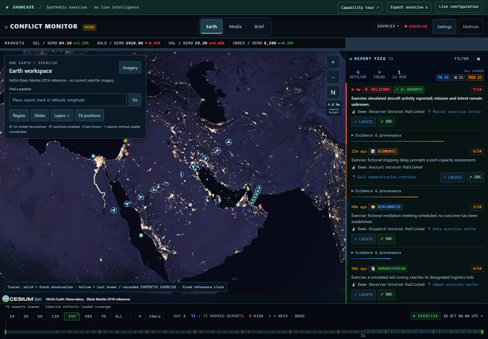

# Conflict Monitor

An OSINT workspace centered on one persistent Google Earth canvas, with source reports, regional ADS-B/AIS, thermal observations, replay, Media and Brief panels. It preserves original evidence and makes source age, unresolved locations and coverage limits visible. Optional local Qwen extraction and Piper/FFmpeg narrated source cards use no paid inference or speech API.

**Version: 0.2.0-rc.1.** See the [release](https://github.com/DankWoodsmoke/conflict-monitor-public/releases/tag/v0.2.0-rc.1), [GitHub CI](https://github.com/DankWoodsmoke/conflict-monitor-public/actions/workflows/verify.yml) and [verification](docs/VERIFICATION.md) for downloads, executed checks and remaining limits. The former server and original private repository were not changed.

[](https://github.com/DankWoodsmoke/conflict-monitor-public/actions/workflows/verify.yml)

## Explore without credentials

Use Node.js 22.12 or newer:

```sh
cd frontend
npm ci
npm run dev
```

Open **http://localhost:5173/?showcase=true**. The explicit exercise uses local cartography and synthetic reports, tracks, media panels, markets and analysis. No database or model service is required. The capability tour opens panels within Earth; export saves the exercise data and reference clock. Earlier `view=map` and `view=3d` links resolve to Earth.

The **Earth** view retains Cesium and Google Photorealistic 3D Tiles. Configure a browser-restricted Google Maps key in Settings to enable the original imagery capability. A self-hosted deployment can set `GOOGLE_EARTH_ENABLED=true` and `GOOGLE_MAPS_BROWSER_KEY` for automatic Earth configuration without rebuilding the frontend. That explicitly public browser key is delivered by `/config`; backend credentials remain server-only. Google requires its Map Tiles API, billing and visible attribution. Earth imagery supplies geographic context; it does not establish an event's date or location. The keyless exercise uses a local reference globe. Enabling Google imagery is a deliberate provider choice independent of synthetic report data.

## Capabilities

| Workspace | Implemented capability | Verification boundary |
| --- | --- | --- |
| Earth | Persistent Cesium/Google imagery, report feed and filters, coordinate/place search, source selection, regional aircraft/vessels, thermal observations, camera controls and replay | Unknown locations stay unplotted. Tracking is explicitly projected onto the surface; no altitude conversion or motion extrapolation is invented. |
| Media panel | External media activation and real locally narrated source-card MP4s, preserving the Earth camera | Video reads attributed reports; it contains no incident footage. External broadcasters retain their own availability and rights. |
| Brief panel | Source digest, report references and optional local topic/stance/mention extraction; inherited analysis remains labeled | Model labels and source mentions remain unreviewed. Literal spans and valid JSON do not establish factual truth or an incident location. |
| Evidence | Preserved original reports, content hashes, source-scoped identities, revisions, explicit extraction failures | Report/network counts never automatically become independent confirmation. |
| Tracking | Four bounded regional ADS-B circles, AIS, explicit fresh/last-known ages, recorded replay and optional navigation-quality candidates | Partial receiver coverage is explicit. Expired positions disappear. Navigation degradation alone does not establish jamming. Active orbital markers and cosmetic sensor-like shaders have been removed. |

The default free profile preserves publisher text with `UNSCORED` severity and unresolved locations unless a sensor supplies coordinates. It never sends those reports to a paid classifier. Optional model-assisted extraction/synthesis requires deliberate configuration and separate accuracy qualification.

## Demonstrate the workspace

1. Open Earth and enable Google imagery through Settings or your deployment's restricted browser key. Check provider attribution and the source-health panel before describing anything as current. The keyless showcase labels its synthetic data and reference globe explicitly.
2. Explore reports and source/time filters, open a cited source, then compare its publication clock with collection time. Unlocated reports stay in the feed. Tracking controls distinguish fresh, last-known and recorded positions; the four aircraft regions describe the actual coverage.
3. Open Media, then return to Earth to show that the camera and canvas persist. External broadcasts need deliberate activation; an embedded page is not proof of live playback. The narrated briefing contains editorial source cards, not incident footage.
4. Open Brief for the attributed source digest and, when configured, optional local analysis. Inspect original citations and unreviewed labels. Local generation requires the operator key and a deliberate action; opening a panel starts no inference or speech job.

The capability tour and export in the keyless showcase can demonstrate these controls without disclosing credentials or redistributing live publisher text. See [verification](docs/VERIFICATION.md) for measured browser, source and media behavior.

## Preview

These are the synthetic, keyless exercise with the NASA Black Marble 2016 reference. Google photorealistic imagery is a separately configured live-provider capability.



Also see [Media](docs/screenshots/clean-showcase-media-desktop-20261029T084844192667Z.png), [Brief](docs/screenshots/clean-showcase-brief-desktop-20261029T084844192667Z.png) and [390-pixel portrait](docs/screenshots/clean-showcase-earth-portrait390-20261029T084844192667Z.png). The previews came from a fresh source reconstruction whose 400 built assets matched the deployed image; screenshots illustrate layout and do not establish source truth.

The optional free tools are configured in [local AI/video](docs/LOCAL_AI_VIDEO.md). The application never pulls a model or voice automatically. Operator-triggered work is authenticated, bounded and published only after its respective validation gates. The measured model comparison includes rejected batches and remaining errors. The inherited paid standalone video script is retained as historical source; automatic paid generation remains disabled by default.

## Self-host with an empty database

Copy `.env.example` to `.env`. Set different new `POSTGRES_PASSWORD` and `POSTGRES_APP_PASSWORD` values (32 random bytes, represented as 64 hexadecimal characters each), plus a new `ADMIN_API_KEY`, then:

```sh
docker compose up --build
```

Open **http://localhost:5173/**. Collection defaults to disabled. Configure your own providers before setting `LIVE_INGESTION_ENABLED=true`. Paid situation reports additionally require `ENABLE_SITREP_GENERATION=true` and a configured model key. Administrative writes require `X-Admin-Key`; a missing server key disables them.

The pinned image runs PostgreSQL 17.11/PostGIS 3.6.4. A one-shot `migrate` service initializes Alembic and grants the separate `monitor` runtime role; HTTP workers receive no database administrator secret. The new default `pgdata17_36` volume deliberately avoids the older volume. **Existing data requires a rehearsed logical restore into a new volume**, with the old volume and rollback profile preserved. Follow [database upgrade and permissions](docs/DB_UPGRADE.md); do not attach the new image directly to old database files. The old server's environment, database and sessions are not bundled.

The original April production dump was recovered separately into a private, isolated archive: all 53,715 rows round-tripped exactly. It contains legacy schema, source-clock anomalies and 5,991 dummy event coordinates, so it was preserved without merging its claims or locations into live data. See [historical recovery](docs/HISTORICAL_RECOVERY.md). No publisher bodies or private database are part of this source release.

Development API: `cd backend && uvicorn app.main:app --host 127.0.0.1 --port 8000`. Vite proxies `/api`; the production frontend uses the same-origin nginx proxy. `/health` checks the database/schema, `/status` reports process state and provider-specific freshness. A running process does not establish fresh upstream observations.

## Verify

```sh
python -m venv .venv
# Windows: .venv/Scripts/python.exe; POSIX: .venv/bin/python
python -m pip install -r backend/requirements-dev.txt
cd backend
python -m pytest -q
cd ../frontend
npm ci
npm test
npm run build
npm audit
```

The fresh-PostGIS gate is `python tools/verify_postgis.py` with `DATABASE_URL` naming a separately initialized `conflict_monitor_test` database. Initialize it through `python -m app.bootstrap` as the administrator, then run the gate as the restricted runtime role. The separate actual HTTP/WebSocket gate can additionally exercise `python tools/verify_live_pipeline.py --public-feed`. Missing infrastructure returns an incomplete/failing exit code. [Actual GitHub CI](docs/qualification/2026-10-29-github-qualified-source-ci.json) passed the hosted build/unit/advisory and restricted-role database/pipeline gates; local live-provider, Google/browser and media observations remain separate evidence.

`python tools/release_gate.py --scan-only` checks the allowlisted public source. `--package-candidate` creates a source ZIP and SHA-256 manifest; it does not certify a stable release. Export excludes secrets, sessions, databases, logs, dependency trees and private Git history.

## Method and research

Read [methodology](docs/METHODOLOGY.md), [current research](docs/CURRENT_RESEARCH.md), [decisions](docs/DECISIONS.md), and [security](SECURITY.md). The structural analytical lens remains visible as testable interpretation; evidence and unknowns remain inspectable.

See [source review](docs/SOURCE_REVIEW.md), [bounded source collection](docs/SOURCE_COLLECTION.md), [free data](docs/FREE_DATA_PIPELINE.md), [container security review](docs/OS_SECURITY_REVIEW.md) and [asset provenance](docs/ASSET_PROVENANCE.md) for source choices, operational bounds and execution receipts. The measured catalog has 34 native feeds; the selected free profile admits 31, with explicit stale/future-clock candidates kept separate. Publisher selection is an editorial lens, not a calibrated truth or first-reporting score.

Current research covers relevant public tools, source terms, formats and model candidates. No general model leaderboard or repository activity claim substitutes for a measured event-extraction evaluation. Model selection is limited to the measured task and sample described below.
 
The October 29 follow-up measured three local models on a frozen twelve-case sample and selected Qwen3.5 4B only for unreviewed source triage. It does not establish general factual or multilingual accuracy. See [Earth behavior](frontend/EARTH_VERIFICATION.md) and [context/history reconciliation](docs/CONTEXT_RECONCILIATION.md) for the consolidation and recovered-history limits.

## License

MIT application code with an explicitly GPL-3.0-or-later standalone optional speech worker, preserving the original copyright notice. See [third-party notices](THIRD_PARTY_NOTICES.md). Dependencies, weights, provider terms and data redistribution rights are separate. No private GOOL corpus/persona, third-party dataset dump, model cache or external platform source code is bundled.
